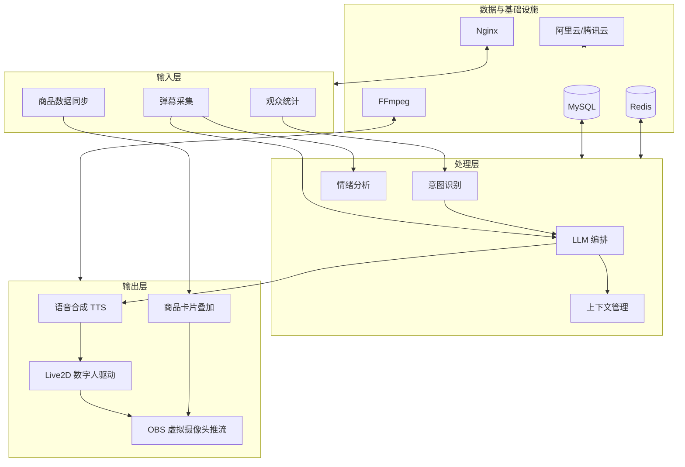

# 青鹿直播（CyanDeer-Live）

面向**农产品带货**场景的 **AI 数字人直播**系统。本仓库负责 **Vue 3 前端**与**直播推流相关说明/示例**（OBS、FFmpeg、SRS）；**Spring Boot 微服务、LLM/ASR/TTS、MySQL/Redis** 等由其他服务/仓库提供，经 HTTP / WebSocket 与本前端对接。

**目标体验：** 观众弹幕或语音 → 采集 / ASR → 意图识别 → LLM 生成回复（约 1–2s）→ TTS（约 1–3s，可与上下文管线并行）→ 数字人口型驱动 → 观众侧端到端感知延迟 **&lt; 3s**（需在全链路持续优化）。

---

## 系统架构（摘要）



---

## 技术选型（与整体项目对齐）

| 模块 | 技术选型 | 说明 |
| --- | --- | --- |
| **LLM** | DeepSeek-V3 / Qwen-Max | 中文能力强、长上下文、成本可控 |
| **ASR** | 阿里 Paraformer 等 | 适合直播间噪声环境 |
| **TTS** | 阿里 CosyVoice / Edge 等 | 自然度与情感合成 |
| **数字人** | **Live2D + Cubism SDK** | Web 易集成、口型驱动成熟 |
| **推流** | **OBS + FFmpeg** | 虚拟摄像头、行业通用 |
| **流媒体** | **SRS** + WebRTC/RTMP（由部署决定） | 与已有后端推流模块对接 |
| **后端** | Spring Boot + MyBatis | 微服务与业务 API |
| **缓存** | Redis | 会话、弹幕队列等 |
| **本仓库前端** | **Vue 3 + Vite + TypeScript + Pinia + Vue Router** | 响应式、按需加载、首屏优化 |

---

## 本仓库目录结构

```
├── src/                      # Vue 3 应用源码
│   ├── components/           # 通用组件（如商品卡片叠加层）
│   ├── layouts/              # 布局
│   ├── modules/live2d/       # Live2D SDK 集成说明（SDK 需单独授权引入）
│   ├── router/               # 路由
│   ├── stores/               # Pinia 状态
│   └── views/                # 页面：概览、直播控制台、商品占位
├── streaming/                # 推流：SRS 示例、FFmpeg 脚本、说明
├── public/
├── .env.example              # 环境变量模板
└── package.json
```

---

## 本地开发

**环境要求：** Node.js 20+（推荐 LTS）。

```bash
cp .env.example .env
npm install
npm run dev
```

浏览器访问开发服务器（默认 `http://localhost:5173`）。

```bash
npm run build     # 类型检查 + 生产构建
npm run preview   # 本地预览构建结果
```

---

## 直播推流（简述）

1. 使用 **OBS** 采集「数字人画面」：可为浏览器源（打开本前端提供的叠加页）或独立渲染窗口。
2. 输出到**虚拟摄像头**或显示器采集，由 OBS **推流**至 **SRS** 或云直播 RTMP。
3. **FFmpeg** 可用于调试推流、转封装或离线转码；示例见 [`streaming/README.md`](streaming/README.md)。

详细步骤与脚本见 **`streaming/`** 目录。

---

## Live2D

Cubism SDK 需按官方授权获取，不宜直接提交到公开仓库。请将运行时放入合适目录并在组件中加载模型；说明见 [`src/modules/live2d/README.md`](src/modules/live2d/README.md)。

---

## 与后端约定（建议）

| 能力 | 建议协议 |
| --- | --- |
| 弹幕 / 信令 | WebSocket（如 `VITE_WS_URL`） |
| 商品、订单、用户 | REST（`VITE_API_BASE_URL`） |
| 播放地址 | 由后端返回 SRS/云端播放 URL，前端只做展示与跳转 |

具体路径以网关与服务拆分为准。

---

## 项目背景与价值（节选）

- **降低农民操作门槛**：极简入口、语音与图文引导、核心步骤可控。
- **农产品特色能力**：产地可视化、标准化展示、物流与溯源等（由后端与业务服务承载）。
- **AI 数字人**：7×24 代播、话术与形象可配置，减轻真人时长压力。
- **弱网适配**：推流端多档位（480P–1080P）、动态码率思路与云端转码配合；前端侧懒加载与资源压缩，目标首屏 **2s 内**（需实测迭代）。

完整论证、进度与参考文献见申报书与课题组材料。

---

## 许可证

代码许可证由项目组约定；**Live2D / 云厂商 SDK** 遵循其各自条款。

---

## 参考资料（课题组列出）

1. AnchorCrafter 等论文与行业白皮书（见课题文档）  
2. 《AI 数字人直播技术与商业应用白皮书》等  
3. 乡村振兴与直播带货相关期刊文献（见申报书参考文献列表）
