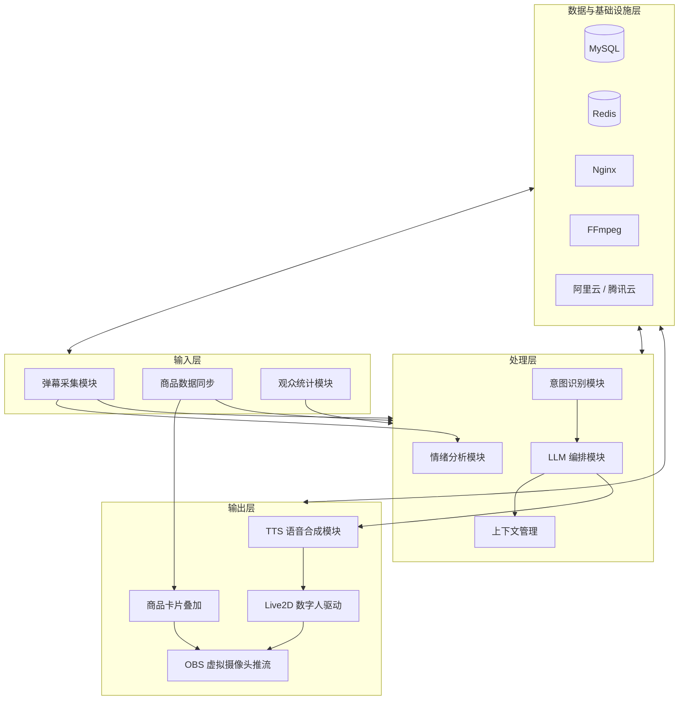

# 青鹿直播（CyanDeer-Live）

面向**农产品带货**的 **AI 数字人直播**系统。本仓库负责 **Vue 3 前端**（含**商品卡片叠加**等输出层展示）与 **推流侧说明/脚本**（与架构图「**OBS 虚拟摄像头推流** + 基础设施层 **FFmpeg**」一致）。**Spring Boot + MyBatis、MySQL、Redis、Nginx、阿里云/腾讯云** 等由后端与运维承载，经 HTTP / WebSocket 与本前端对接。

**端到端体验目标：** 观众弹幕或语音 → 采集 / ASR → 意图识别 → LLM（约 1–2s）→ TTS（约 1–3s，可与上下文并行）→ Live2D 口型驱动 → **OBS 虚拟摄像头推流** → 观众侧总延迟 **&lt; 3s**（持续优化）。

---

## 系统架构（与立项图一致）

分层与模块命名如下（上下层与**数据与基础设施层**双向支撑）。



---

## 技术选型（与立项表一致）

| 模块 | 技术选型 | 选型理由 |
| --- | --- | --- |
| **LLM** | DeepSeek-V3 / Qwen-Max | 中文理解能力强、成本低、支持长上下文 |
| **ASR** | 阿里 Paraformer | 抗噪声能力好，适合直播环境 |
| **TTS** | 阿里 CosyVoice / Microsoft Edge | 音色自然，支持情感语音合成 |
| **数字人** | Live2D + Cubism SDK | 轻量、易集成 Web、口型驱动成熟 |
| **推流** | **OBS + FFmpeg** | 业界通用工具，**支持虚拟摄像头** |
| **后端** | Spring Boot + MyBatis | 运行稳定、生态成熟 |
| **缓存** | Redis | 会话管理、弹幕队列 |
| **本仓库** | Vue 3 + Vite + TypeScript + Pinia + Vue Router | 响应式前端、商品叠加与控制台 |

---

## 本仓库在架构中的位置

| 架构模块 | 本仓库对应 |
| --- | --- |
| **商品卡片叠加** | `src/components/ProductCardOverlay.vue`；路由 **`/overlay?productId=`**（透明底，OBS 源勾选允许透明） |
| **数字人 + 叠加（单浏览器源）** | 路由 **`/scene?productId=`**：`DigitalHumanPlaceholder` + 商品卡片，便于无 Cubism 时先联调构图 |
| **OBS 虚拟摄像头推流** | 主播侧操作见 [`streaming/README.md`](streaming/README.md)；**直播控制台**可一键复制上述 URL |
| **Live2D 数字人驱动** | 在 `Scene` 页替换占位区，说明见 [`src/modules/live2d/README.md`](src/modules/live2d/README.md) |
| **FFmpeg** | 基础设施层：脚本见 [`streaming/`](streaming/) |
| **接口** | `GET /api/products`、**WebSocket** `VITE_WS_URL` 弹幕；未通时使用本地示例数据 + 测试弹幕 |

---

## 目录结构

```
├── src/                      # Vue 3：控制台、商品叠加、Live2D 接入说明
├── streaming/                # OBS 虚拟摄像头流程说明 + FFmpeg 示例脚本
├── public/
├── .env.example
└── package.json
```

---

## 本地开发

**环境要求：** Node.js 20+（推荐 LTS）。

```bash
cp .env.example .env
npm install
npm run dev
```

```bash
npm run build
npm run preview
```

---

## 直播推流（立项口径）

- **输出层**：**OBS 虚拟摄像头推流** — 将合成后的数字人画面（含浏览器源加载的本前端页面）输出为系统摄像头，供直播伴侣等采集。详见 [`streaming/README.md`](streaming/README.md)。
- **基础设施层**：**FFmpeg** — 用于服务端或脚本侧媒体处理、调试推流；与 OBS 分工见 `streaming` 文档。

---

## Live2D / Cubism SDK

按 Live2D 授权引入运行时与模型；不宜将 SDK 文件提交至公开仓库。

---

## 与后端约定（建议）

| 能力 | 协议 |
| --- | --- |
| 弹幕 / 信令 | WebSocket（`VITE_WS_URL`） |
| 商品、用户等 | REST（`VITE_API_BASE_URL`） |

---

## 项目背景与价值（节选）

降低农民操作门槛；农产品产地溯源、标准化展示、物流对接；**农民 - 消费者 - 服务商**协同；弱网与首屏优化见申报书。

---

## 许可证

项目组约定为准；Live2D / 云厂商 SDK 遵循各自条款。

---

## 参考资料

课题申报书及所列参考文献（AnchorCrafter、电子商务评论、《AI 数字人直播技术与商业应用白皮书》等）。
